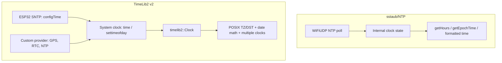

# TimeLib2 vs sstaub/NTP

This document compares TimeLib2 v2 with the popular
[sstaub/NTP](https://github.com/sstaub/NTP) library. The two libraries overlap
less than their names might suggest, so the useful question is not "which is
better?" but "which layer are you solving for?"

**Summary:** sstaub/NTP is an NTP client that owns its own clock. TimeLib2 v2 is
a timekeeping abstraction over the ESP32 system clock. TimeLib2 is therefore not
automatically better at fetching NTP time; it is better at being the time
foundation an application shares.



## Side-by-side

| Dimension | sstaub/NTP | TimeLib2 v2 |
| --- | --- | --- |
| Primary role | NTP client plus its own clock | Time/date abstraction over the ESP32 system clock |
| NTP transport | Implements UDP NTP itself | Does not; uses ESP32 SNTP (`configTime`) or your provider |
| Time sources | NTP | SNTP, GPS, RTC, custom; swappable via `setSyncProvider()` |
| System-clock integration | Generally maintains internal state; other code using `time()` may not see it | Reads/writes `time()`/`settimeofday()`, so the whole application agrees |
| Timezone/DST | Typically a numeric offset plus a DST flag | POSIX `TZ` strings with automatic DST rules via `localtime_r()` |
| Multiple clocks | Usually one instance/timezone | Multiple `Clock` instances with independent offsets, status, and providers |
| Date math | Getters and formatted output | [`breakTime()`](../TimeConversions.cpp)/`makeTime()`, leap-year-correct conversions, day/week helpers, date strings |
| Deep sleep | Internal RAM state is typically lost on wake | System/RTC clock persists when the RTC keeps time |
| 64-bit `time_t` | Depends on implementation | Native 64-bit `time_t`, no 2038 truncation |
| API hygiene | Arduino-style API | `namespace timelib2`, `enum class`, `constexpr`, `noexcept`, thread-friendly |
| Platform support | Broader, typically ESP8266/ESP32 | **ESP32 only** by design |
| Footprint | Smaller if you only need NTP | Larger, because it carries date/TZ utilities |
| NTP control | Direct control over server, port, and polling | Control lives in ESP32 SNTP or your provider |

> These are general design differences. Verify the current sstaub/NTP release
> for exact feature details.

## Where TimeLib2 adds real value

1. **One coherent time for the whole application.** Because TimeLib2 drives
   `time()`/`settimeofday()`, TLS certificate checks, log timestamps, MQTT,
   schedulers, and other libraries all see the same time. An NTP client with a
   private clock often does not update the system clock.
2. **No duplicate network stack.** It rides on ESP32 SNTP rather than running a
   second UDP polling loop, which is simpler and plays better with WiFi power
   management.
3. **Correct DST, not just a boolean.** A POSIX `TZ` string such as
   `GMT0BST,M3.5.0/1,M10.5.0` handles the actual transition dates, unlike a
   manual "DST on/off" flag.
4. **Time-source abstraction.** The same [`Clock`](../TimeLib2.hpp) can be fed by
   SNTP, GPS, an RTC, or an NTP client. You can change the source without
   rewriting application code.
5. **Multiple display clocks.** One `Clock` per timezone/offset is useful for
   dashboards that show several zones at once.
6. **Date infrastructure.** `breakTime`, `makeTime`, weekday/midnight/week
   helpers, month/day strings, and leap-year-correct conversion are a toolkit an
   NTP client does not provide.
7. **Deep-sleep and 2038 safety.** The system RTC keeps time across deep sleep,
   and the 64-bit path avoids the 2038 cliff.
8. **Modern, testable API.** Namespaced, bounded string lookups, validated
   `setTime()`, atomics for sync bookkeeping, and a host-testable conversion
   core.

## Where sstaub/NTP is the better fit

1. **You only need "get time from NTP."** Its one-object,
   `begin()`/`update()`/getter model is simpler than adopting a timekeeping
   layer.
2. **You want a self-contained NTP client.** It does not depend on ESP32
   `configTime`/SNTP and gives direct control over the NTP server, port, and
   polling interval.
3. **You need portability beyond ESP32.** TimeLib2 v2 is deliberately ESP32-only
   (`architectures=esp32`, `platforms: ["espressif32"]`).
4. **You want the smallest footprint.** If you do not need date math or POSIX TZ
   support, the NTP client alone is leaner.
5. **You intentionally want an isolated timebase** that does not mutate global
   system time.
6. **You need NTP-specific behaviour** such as packet handling, retries, or
   custom polling semantics that TimeLib2 delegates to ESP32 SNTP.

## They compose well

You can use sstaub/NTP purely as a provider and let TimeLib2 own the
application-facing time model:

```cpp
#include <NTP.h>
#include <TimeLib2.hpp>

NTP ntp;
timelib2::Clock timeClock;

time_t ntpProvider(void*) {
  return ntp.getEpochTime();  // keep NTP's own TZ/DST at zero so this is UTC
}

void setup() {
  ntp.begin("pool.ntp.org");
  ntp.setTimeZone(0);
  ntp.setDST(false);

  timeClock.setSyncProvider(ntpProvider);
  timeClock.setTimeZone("GMT0BST,M3.5.0/1,M10.5.0");
}

void loop() {
  ntp.update();  // refresh the cached NTP value
  // timeClock.now() invokes the provider when a sync is due
}
```

## Verdict

- If the requirement is simply "fetch the time from an NTP server and display
  it," **sstaub/NTP is a reasonable, simpler choice**, and TimeLib2 does not
  inherently beat it for that narrow job.
- If time is a **shared application service** needed by TLS, logging,
  scheduling, multiple timezones, GPS/RTC fallback, and deep-sleep persistence,
  TimeLib2 provides the integration, timezone correctness, and date
  infrastructure that an NTP client alone does not.
- The strongest option is often both: an NTP client as the wire-level source,
  and TimeLib2 as the application-facing clock. The current TimeLib2 time model
  and provider contract are documented in [`Readme.md`](../Readme.md), with the
  conversion core isolated in [`TimeConversions.cpp`](../TimeConversions.cpp).
